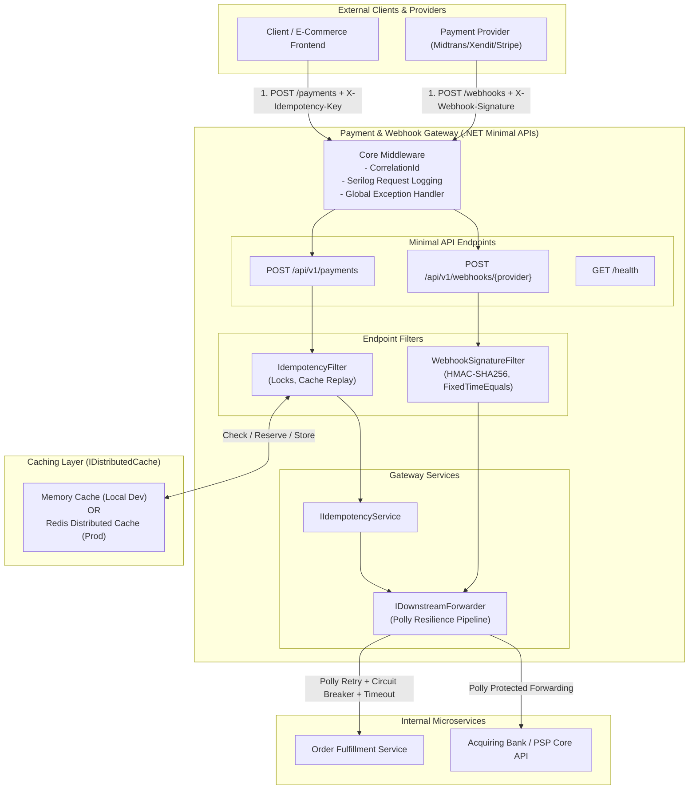
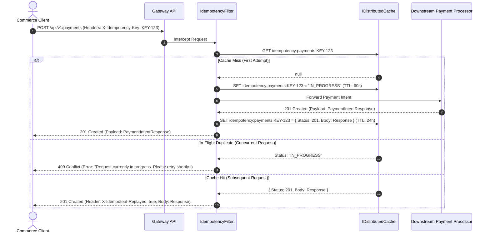
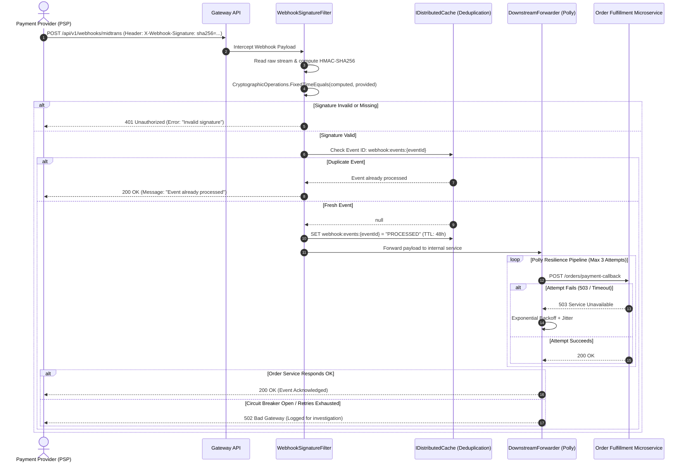

# System Architecture & Design Specification

## Payment & Webhook Gateway Service

| Attribute | Details |
| :--- | :--- |
| **Document Version** | 1.0.0 |
| **Status** | Approved / Engineering Ready |
| **Architectural Style** | Modular Minimal API Gateway, Filter Pipeline, Cache-backed Middleware |

---

## 1. High-Level Architecture

The Payment & Webhook Gateway operates as a high-throughput, low-latency ingestion and mediation tier placed between external actors (Client Apps, Payment Providers) and downstream internal order/fulfillment services.



---

## 2. Interaction Sequence Diagrams

### Flow A: Payment Intent Creation (Idempotency Hit vs. Miss)



### Flow B: Webhook Callback Verification & Polly Resilience Flow




---

## 3. Codebase Structure & Architectural Responsibilities

The codebase follows Clean Architecture principles adapted for .NET 10 Minimal APIs, maximizing cohesion and decoupling:

```
PaymentGateway.Api/
├── Configuration/               # Options pattern & strongly-typed settings
│   ├── GatewayOptions.cs        # Redis, TTL, and endpoint settings
│   ├── WebhookOptions.cs        # Provider secret keys (Midtrans, Xendit, etc.)
│   └── ResilienceOptions.cs     # Polly retry, circuit breaker & timeout thresholds
├── Endpoints/                   # Minimal API route definitions & route groups
│   ├── PaymentEndpoints.cs      # MapPost("/api/v1/payments")
│   ├── WebhookEndpoints.cs      # MapPost("/api/v1/webhooks/{provider}")
│   └── DiagnosticEndpoints.cs    # MapGet("/health")
├── Filters/                     # Reusable Endpoint Filters (IEndpointFilter)
│   ├── IdempotencyFilter.cs     # Header validation, locking, and replay logic
│   └── WebhookSignatureFilter.cs# HMAC verification & stream buffering
├── Middleware/                  # HTTP pipeline middleware
│   ├── CorrelationIdMiddleware.cs
│   └── ExceptionHandlingMiddleware.cs
├── Models/                      # DTOs, domain models, and standardized envelopes
│   ├── Requests/
│   │   ├── CreatePaymentRequest.cs
│   │   └── WebhookPayload.cs
│   ├── Responses/
│   │   ├── PaymentIntentResponse.cs
│   │   ├── WebhookAckResponse.cs
│   │   └── ApiErrorResponse.cs
│   └── IdempotencyEntry.cs      # Serialized cache structure
└── Services/                    # Business & infrastructure services
    ├── IIdempotencyService.cs   # Abstraction over IDistributedCache
    ├── IdempotencyService.cs
    ├── IDownstreamForwarder.cs  # Resilient forwarding client
    └── DownstreamForwarder.cs   # Implementation wrapped in Polly pipeline
```

### Responsibility Breakdown
1. **`Configuration/`**: Holds configuration records bound via `IOptions<T>` from `appsettings.json` and User Secrets. Prevents hardcoded parameters across filters.
2. **`Endpoints/`**: Pure route mapping definitions. Endpoints stay minimal; they delegate domain validation and execution to filters and services.
3. **`Filters/`**: Cross-cutting concerns implemented as `IEndpointFilter`. Allows testable, composable pre/post-invocation processing without polluting business logic.
4. **`Models/`**: Strongly typed immutable records with validation annotations. Implements RFC 7807 problem details via `ApiErrorResponse`.
5. **`Services/`**: Encapsulates external interactions (caching and HTTP dispatching). Handles distributed serialization, lock TTLs, and Polly resilience executions.

---

## 4. API Contract Specifications

### 4.1 Payment Intent Creation

* **Endpoint**: `POST /api/v1/payments`
* **Content-Type**: `application/json`

#### HTTP Headers
| Header | Type | Required | Description |
| :--- | :--- | :--- | :--- |
| `X-Idempotency-Key` | String (UUID/String) | **Yes** | Client-generated unique transaction identifier (max 128 chars). |
| `X-Correlation-Id` | String (UUID) | Optional | Distributed trace identifier; generated by gateway if absent. |

#### Request Payload Schema
```json
{
  "orderId": "ORD-2026-9812",
  "amount": 150000.00,
  "currency": "IDR",
  "paymentMethod": "credit_card",
  "customer": {
    "id": "CUST-4521",
    "name": "Jane Doe",
    "email": "jane.doe@example.com"
  },
  "metadata": {
    "sourcePlatform": "mobile_app_v2"
  }
}
```

#### Response Payload Schema (`201 Created` / Replay `201 Created`)
*Response Headers on Replay: `X-Idempotent-Replayed: true`*
```json
{
  "paymentIntentId": "pi_live_9a8b7c6d5e4f",
  "orderId": "ORD-2026-9812",
  "status": "Pending",
  "amount": 150000.00,
  "currency": "IDR",
  "clientSecret": "pi_sec_k3j4h5g6f7d8",
  "createdAt": "2026-11-14T10:15:30Z",
  "expiresAt": "2026-11-14T10:45:30Z"
}
```

### 4.2 Webhook Ingestion

* **Endpoint**: `POST /api/v1/webhooks/{provider}`
* **Route Parameter**: `provider` (e.g., `midtrans`, `xendit`, `stripe`)

#### HTTP Headers
| Header | Type | Required | Description |
| :--- | :--- | :--- | :--- |
| `X-Webhook-Signature` | String | **Yes** | HMAC-SHA256 signature in format `sha256=<hex_digest>`. |
| `X-Webhook-Timestamp` | String (Unix) | Optional | Timestamp generated by provider for anti-replay verification. |

#### Standardized Response Payload (`200 OK`)
```json
{
  "status": "success",
  "provider": "midtrans",
  "eventId": "evt_88329401",
  "processedAt": "2026-11-14T10:15:32Z"
}
```

### 4.3 Standard Error Envelope (`ApiErrorResponse`)

Conforms to RFC 7807 Problem Details for all 4xx/5xx responses:
```json
{
  "type": "https://errors.paymentgateway.internal/idempotency-conflict",
  "title": "Idempotency Conflict",
  "status": 409,
  "detail": "An identical request with key 'KEY-123' is currently processing.",
  "instance": "/api/v1/payments",
  "correlationId": "0193297a-93be-7000-9831-2fb11d4e0821",
  "timestamp": "2026-11-14T10:15:31Z"
}
```

