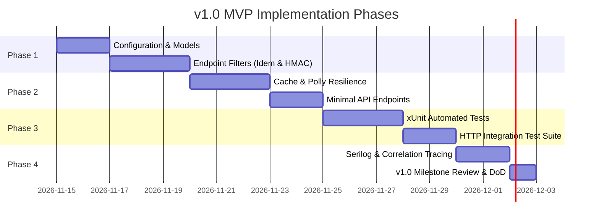

# Initial Build Roadmap (v1.0 MVP)

## Payment & Webhook Gateway Service

| Attribute | Details |
| :--- | :--- |
| **Document Version** | 1.0.0 |
| **Status** | Approved / Engineering Ready |
| **Target Milestone** | v1.0.0 Production-Ready MVP |

---

## 1. Overview & Phased Execution Strategy

This document details the engineering execution plan for implementing the **Payment & Webhook Gateway Service**. The roadmap is structured into four sequential, test-driven phases to guarantee zero regressions, clean separation of concerns, and immediate verification at every step.

---

## 2. Phase Breakdown

### Phase 1: Foundation, Configuration, Models & Endpoint Filters

#### 1.1 Strongly-Typed Configuration & Options Pattern
* Bind and validate configuration objects from `appsettings.json`:
  * `GatewayOptions`: Cache configuration (`UseRedis`, `RedisConnectionString`, `IdempotencyLockTtlSeconds`, `IdempotencyRetentionTtlHours`).
  * `WebhookOptions`: Map of provider secrets (e.g., `MidtransSecret`, `XenditSecret`).
  * `ResilienceOptions`: Retry counts, backoff intervals, circuit breaker thresholds, and timeout seconds.
* Configure `dotnet user-secrets` for local developer secret isolation.

#### 1.2 Models & Response Envelopes
* Create immutable C# records in `Models/`:
  * Requests: `CreatePaymentRequest`, `WebhookPayload`.
  * Responses: `PaymentIntentResponse`, `WebhookAckResponse`, `ApiErrorResponse` (RFC 7807 compliant).
  * Storage: `IdempotencyEntry` representing serialized cache state (Status, Headers, Body, Timestamp).

#### 1.3 `IdempotencyFilter` (`Filters/IdempotencyFilter.cs`)
* Implement `IEndpointFilter`:
  * Enforce presence of `X-Idempotency-Key` header (reject missing header with `400 Bad Request`).
  * Check `IDistributedCache` for existing key state.
  * If `IN_PROGRESS`, abort pipeline immediately with `409 Conflict`.
  * If hit, short-circuit pipeline and return cached response with `X-Idempotent-Replayed: true`.
  * If miss, set reservation marker and execute endpoint, capturing result for post-invocation caching.

#### 1.4 `WebhookSignatureFilter` (`Filters/WebhookSignatureFilter.cs`)
* Implement `IEndpointFilter`:
  * Enable stream buffering on `HttpRequest` (`EnableBuffering()`).
  * Extract `X-Webhook-Signature` header; reject missing header with `401 Unauthorized`.
  * Read raw byte stream without closing stream and compute HMAC-SHA256 digest using provider secret.
  * Verify signature via `CryptographicOperations.FixedTimeEquals`.
  * Reset stream position (`Position = 0`) before delegating to route handler.

---

### Phase 2: Business Services, Polly Resilience Pipeline & Minimal API Endpoints

#### 2.1 Distributed Cache Abstraction (`Services/IdempotencyService.cs`)
* Encapsulate key serialization, JSON options, and distributed operations over `IDistributedCache`.
* Seamlessly support both `AddDistributedMemoryCache()` and `AddStackExchangeRedisCache()` based on `GatewayOptions.UseRedis`.

#### 2.2 Resilient Downstream Forwarder (`Services/DownstreamForwarder.cs`)
* Configure `HttpClient` using `Microsoft.Extensions.Http.Resilience` (Polly v8):
  * **Retry Strategy**: 3 attempts with exponential backoff and decorrelated jitter.
  * **Circuit Breaker**: 50% failure rate over 30 seconds triggers open state (break duration: 15s).
  * **Total Request Timeout**: 5 seconds per attempt; 15 seconds overall.
* Implement forwarder logic to dispatch validated payment intents and verified webhooks to downstream target URLs.

#### 2.3 Minimal API Endpoint Mappings (`Endpoints/`)
* `PaymentEndpoints.cs`:
  * Map `POST /api/v1/payments`.
  * Attach `.AddEndpointFilter<IdempotencyFilter>()`.
  * Validate request, invoke downstream processor, return `201 Created`.
* `WebhookEndpoints.cs`:
  * Map `POST /api/v1/webhooks/{provider}`.
  * Attach `.AddEndpointFilter<WebhookSignatureFilter>()`.
  * Perform event ID deduplication, forward to order service via `IDownstreamForwarder`, return `200 OK`.
* `DiagnosticEndpoints.cs`:
  * Map `GET /health` with cache connection and forwarder health checks.

---

### Phase 3: Automated Testing & Verification

#### 3.1 Unit Testing Suite (`PaymentGateway.Tests`)
* Test `IdempotencyFilter`:
  * Verify `400 Bad Request` on missing `X-Idempotency-Key`.
  * Verify cache miss invokes next filter delegate and saves response.
  * Verify cache hit returns identical response with `X-Idempotent-Replayed: true`.
  * Verify concurrent execution returns `409 Conflict`.
* Test `WebhookSignatureFilter`:
  * Verify valid HMAC-SHA256 returns success.
  * Verify tampered payload or incorrect secret fails with `401 Unauthorized`.
  * Verify constant-time comparison prevents timing discrepancies.
* Test Polly resilience handlers via mocked HTTP message handlers (verifying retries and circuit breaker transitions).

#### 3.2 Integration Testing (`PaymentGateway.Api.http`)
* Create a complete `.http` file covering:
  1. Payment creation without idempotency key -> expect `400 Bad Request`.
  2. First payment creation with key -> expect `201 Created`.
  3. Replay payment creation with same key -> expect `201 Created` with `X-Idempotent-Replayed: true`.
  4. Webhook with invalid signature -> expect `401 Unauthorized`.
  5. Webhook with valid HMAC-SHA256 signature -> expect `200 OK`.
  6. Duplicate webhook event -> expect `200 OK` (deduplicated).
  7. Health check -> expect `200 OK`.

---

### Phase 4: Local Observability & Diagnostics

#### 4.1 Structured Logging with Serilog
* Configure Serilog in `Program.cs` with `WriteTo.Console(new JsonFormatter())` or structured theme.
* Enrich logs with `FromLogContext()`, capturing `CorrelationId`, `Endpoint`, `StatusCode`, and execution duration.

#### 4.2 Correlation ID Middleware
* Intercept all requests; read `X-Correlation-Id` or generate a new `Guid`.
* Add `CorrelationId` to `HttpContext.TraceIdentifier`, push to Serilog `LogContext`, and mirror back in response headers.

---

## 3. Definition of Done (DoD) Checklist for v1.0 MVP

To achieve v1.0 production-ready sign-off, the service must fulfill every criterion below:

- [ ] **Architecture**: All endpoints implemented as .NET 10 Minimal APIs using clean folder layout.
- [ ] **Idempotency**: 100% deduplication of repeated requests; `X-Idempotent-Replayed: true` header verified.
- [ ] **Signature Verification**: HMAC-SHA256 verified using `CryptographicOperations.FixedTimeEquals` across all webhook requests.
- [ ] **Resilience**: Downstream HTTP communication guarded by Polly retry, timeout, and circuit breaker.
- [ ] **Portability**: Service boots in zero-dependency mode out-of-the-box (`UseRedis: false`), and switches to Redis (`UseRedis: true`) without code changes.
- [ ] **Automated Testing**: All unit tests in `PaymentGateway.Tests` pass with 100% green status; `.http` test suite passes.
- [ ] **Security**: Zero committed secrets; all error responses conform to RFC 7807 problem details with zero leaked stack traces.
- [ ] **Observability**: Structured Serilog logs output correlation IDs for every request.

