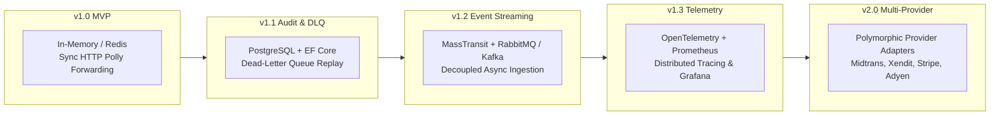
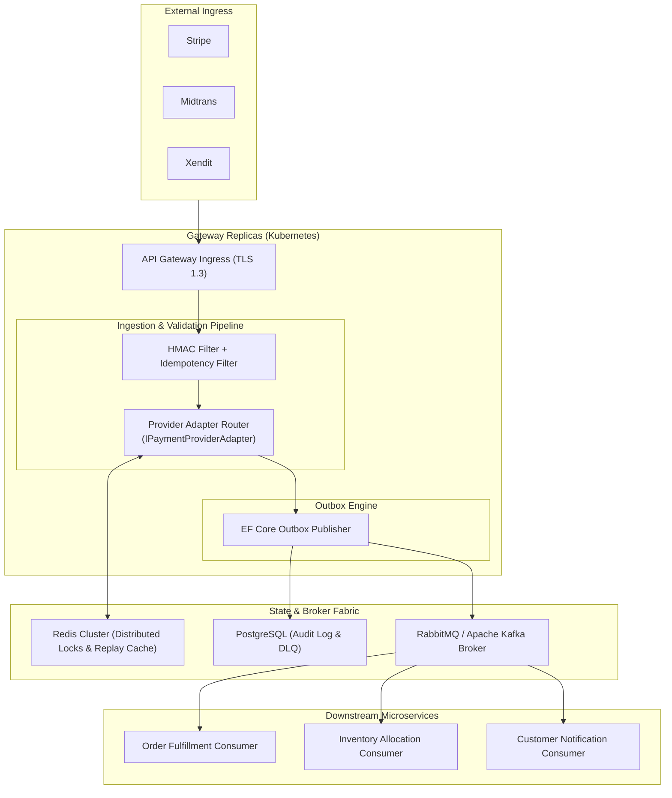

# Post-MVP Evolution & Scaling Roadmap

## Payment & Webhook Gateway Service

| Attribute | Details |
| :--- | :--- |
| **Document Version** | 1.0.0 |
| **Status** | Approved / Engineering Strategy |
| **Target Horizon** | Post-v1.0 (v1.1 to v2.0+) |

---

## 1. Strategic Architectural Vision

The v1.0 release establishes an ultra-fast, lightweight, memory/cache-backed gateway middleware. As transaction volumes expand from hundreds to tens of thousands of requests per second, the architecture will systematically evolve into an enterprise-grade, distributed, event-driven payment fabric without requiring fundamental rewrites of the core endpoint filters.

---

## 2. Milestone Evolution Specifications

### 2.1 Milestone v1.1: Persistent Audit Trails & Dead-Letter Queue (DLQ)

* **Objective**: Introduce durable database persistence for legal compliance, audit logging, and manual intervention on poison/failed webhooks.
* **Core Deliverables**:
  1. **Relational Persistence Layer**: Introduce PostgreSQL with Entity Framework Core (`Npgsql.EntityFrameworkCore.PostgreSQL`).
  2. **Audit Logging**: Persist immutable records of all inbound webhook deliveries (`raw_payload`, `signature`, `received_at`, `status`).
  3. **Dead-Letter Queue (DLQ)**:
     * When downstream forwarding fails after all Polly retries, persist the failed event into a `webhook_dlq` table with full failure context.
     * Expose an authenticated administrative replay endpoint (`POST /api/v1/admin/dlq/{id}/retry`) to manually re-dispatch dead-lettered webhooks.

### 2.2 Milestone v1.2: Asynchronous Event Streaming with MassTransit (RabbitMQ / Kafka)

* **Objective**: Decouple incoming webhook ingestion from downstream order processing to achieve sub-10ms response times back to PSPs.
* **Core Deliverables**:
  1. **Message Broker Integration**: Adopt **MassTransit** backed by **RabbitMQ** (standard) or **Apache Kafka** (high-scale).
  2. **Transactional Outbox Pattern**: Guarantee at-least-once message delivery by saving events in the gateway database and publishing asynchronously.
  3. **Ingestion Optimization**:
     * Inbound webhooks acknowledge payment providers with `202 Accepted` immediately upon cryptographic validation and broker publication.
     * Downstream consumer services process events independently without placing latency pressure on the gateway HTTP thread pool.

### 2.3 Milestone v1.3: Enterprise Observability & OpenTelemetry

* **Objective**: Gain deep real-time visibility into gateway performance, circuit breaker transitions, and cross-service traces.
* **Core Deliverables**:
  1. **Distributed Tracing**: Integrate `OpenTelemetry` SDK with W3C TraceContext propagation across downstream HTTP clients and message publishers.
  2. **Prometheus Metrics**: Expose `/metrics` scraping endpoint tracking:
     * `gateway_requests_total` (labeled by endpoint, status code, provider).
     * `idempotency_cache_hits_total` vs. `idempotency_cache_misses_total`.
     * `polly_circuit_breaker_state` (closed, open, half-open).
     * `webhook_verification_duration_seconds`.
  3. **Grafana Dashboards**: Supply pre-built JSON dashboards for production SRE monitoring and alerting.

### 2.4 Milestone v2.0: Multi-Provider Adapter & Strategy Pattern

* **Objective**: Support disparate payment providers (Midtrans, Xendit, Stripe, Adyen, PayPal) through a pluggable, unified domain model.
* **Core Deliverables**:
  1. **Unified Interface (`IPaymentProviderAdapter`)**:
     * Polymorphic signature verification logic tailored per provider.
     * Transformation of vendor-specific webhook JSON schemas into standardized domain events (`PaymentCapturedEvent`, `PaymentRefundedEvent`, `PaymentDisputedEvent`).
  2. **Dynamic Provider Dispatch**: Resolve adapters dynamically at runtime based on route parameter (`/api/v1/webhooks/{provider}`) using keyed dependency injection (`[FromKeyedServices]`).

---

## 3. Target State Enterprise Architecture (v2.0)

